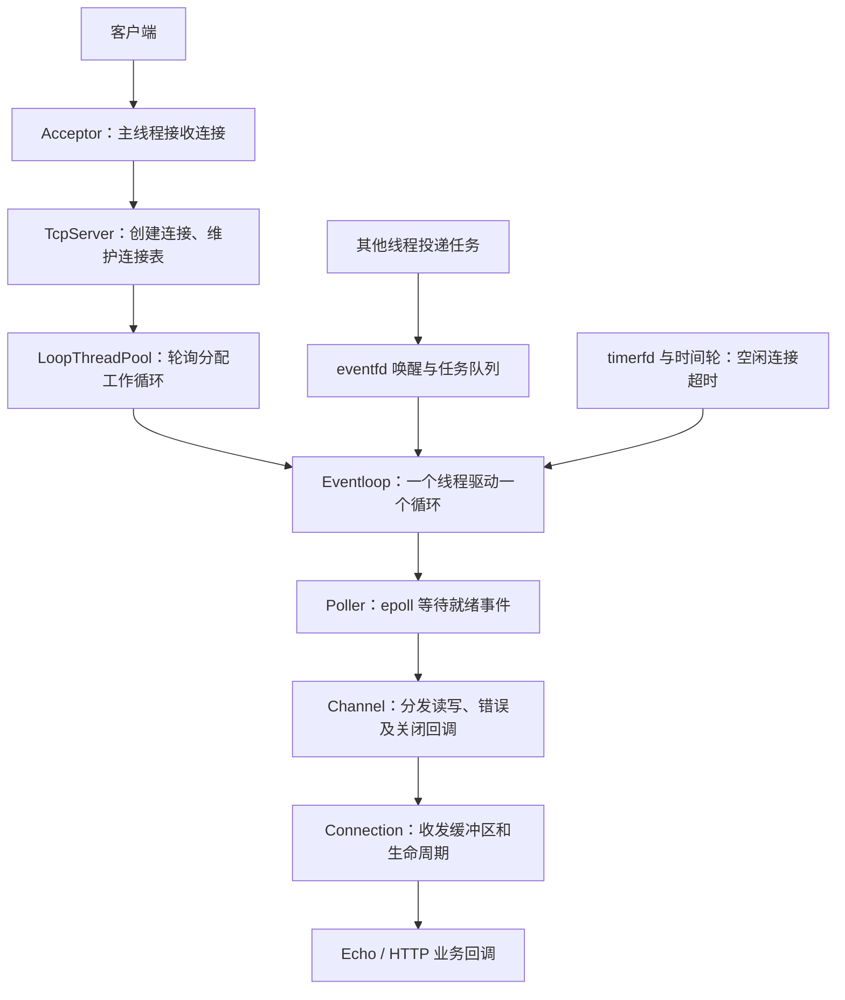

# Cpp-reactor-server

基于 Linux `epoll`、Reactor 模式和 **One Thread One Loop** 模型实现的 C++ 网络服务器学习项目。在 TCP 网络框架上实现 Echo 回显服务和基础 HTTP 服务，用于学习事件分发、跨线程任务投递、连接生命周期、时间轮和 HTTP 报文解析。

## 项目组成

- **网络核心**：`source/server.hpp`，封装 Socket、缓冲区、Channel、Poller、事件循环、线程池、连接管理和定时器。
- **Echo 示例**：`source/echo/`，收到数据后原样返回，发送完成后关闭连接。
- **HTTP 示例**：`source/http/`，实现基础 HTTP/1.0、HTTP/1.1 请求处理、静态文件访问和按请求方法分发的路由。
- **日志工具**：`logs/` 复用我此前独立实现并发布的 [DualLog：C++ 同步/异步日志系统](https://github.com/33615517/Cpp-Sync-Async-Logging-System)，用于打印日志、辅助开发和调试。仓库包含所需源码，克隆后无需另外下载日志库。
- **压测工具**：`WebBench/` 是第三方 WebBench 1.5，用于测试 HTTP 服务吞吐量，保留上游源码说明和许可证。
- **测试与练习**：`test/` 放连接和 HTTP 场景测试；`example/` 放开发过程中使用的独立组件练习。

## 核心设计



| 组件 | 职责 |
| --- | --- |
| `Buffer` | 管理读写偏移，支持整理空间、扩容、按行读取和数据消费 |
| `Socket` | 封装 TCP socket 创建、绑定、监听、连接、收发和选项设置 |
| `Channel` | 保存文件描述符关注的事件及事件回调 |
| `Poller` | 封装 `epoll_ctl()`、`epoll_wait()`，维护 fd 与 Channel 的映射 |
| `TimeTask` / `TimerWheel` | 用共享引用管理定时任务，支持添加、刷新与取消 |
| `Eventloop` | 分发 I/O 回调，执行任务队列，通过 `eventfd` 接收跨线程通知 |
| `LoopThread` / `LoopThreadPool` | 在线程内创建事件循环，轮询分配新连接 |
| `Any` | 保存协议相关的连接上下文 |
| `Connection` | 管理连接状态、收发缓冲区、关闭流程及空闲超时 |
| `Acceptor` / `TcpServer` | 组装监听器、主循环、工作线程和业务回调 |

主线程负责接收连接和维护连接表；每条连接的 I/O 和业务回调由其所属工作循环执行。未配置工作线程时，连接由主循环处理。

发送数据先进入输出缓冲区，在可写事件到来时发送。`Shutdown()` 等待剩余输出发送完成，`Release()` 将实际释放投递到事件循环任务队列，避免就绪事件回调尚未结束就销毁连接。

当前使用 **LT 水平触发**。时间轮每秒推进一格，共 60 个槽，没有跨轮计数，定时任务延迟应控制在 **1～60 秒**。

### HTTP 功能

- 分阶段解析请求行、头字段和按 `Content-Length` 指定的正文。
- 请求可分多次到达，同一连接上的多条完整请求可依次处理。
- 支持 GET、HEAD、POST、PUT、DELETE 的基础处理。
- 提供 URL 编解码、查询参数获取、MIME 类型映射、状态码和重定向接口。
- 支持长短连接、静态文件访问，以及按请求方法和正则表达式匹配的路由。

实现范围以课程学习和本地测试为主，当前没有实现 TLS、WebSocket 或 HTTP chunked 正文解析。

## 目录说明

```text
Cpp-reactor-server/
├── source/
│   ├── server.hpp             # Reactor 网络核心
│   ├── echo/                  # TCP 回显示例
│   │   ├── echo.hpp
│   │   ├── main.cc
│   │   └── makefile
│   └── http/                  # HTTP 协议层和示例服务
│       ├── http.hpp
│       ├── main.cc
│       ├── makefile
│       ├── mine               # MIME 类型映射资料
│       ├── statu              # HTTP 状态码资料
│       └── wwwroot/index.html # 静态演示页面
├── logs/                      # 复用的自研 DualLog 日志工具
├── test/                      # TCP / HTTP 场景测试
├── example/                   # 组件练习与验证程序
├── WebBench/                  # 第三方 HTTP 压测工具
├── .gitignore
└── README.md
```

可执行文件、对象文件、运行日志和上传测试的大文件由本地构建或生成，不提交到仓库。

## 环境与构建

需要 Linux、支持 C++20 的 GCC/G++、GNU Make 和 pthread。项目使用 `epoll`、`eventfd`、`timerfd`，不直接支持 Windows 或 macOS。

Ubuntu / Debian 可以安装：

```bash
sudo apt update
sudo apt install build-essential curl python3
```

克隆并编译：

```bash
git clone https://github.com/33615517/Cpp-reactor-server.git
cd Cpp-reactor-server

make -C source/http
make -C source/echo
make -C test
make -C example
make -C WebBench webbench
```

各 C++ makefile 支持 `CXX`、`CPPFLAGS`、`CXXFLAGS` 和 `LDFLAGS`。需要开启优化时，例如：

```bash
make -C source/http -B CXXFLAGS='-std=c++20 -O2'
```

## 运行 HTTP 服务

从 HTTP 示例目录启动，让相对静态目录 `./wwwroot/` 指向正确位置：

```bash
cd source/http
./main
```

另开终端测试：

```bash
curl -i http://127.0.0.1:8080/
curl -i http://127.0.0.1:8080/hello
curl -I http://127.0.0.1:8080/hello
curl -i -X POST http://127.0.0.1:8080/login -d 'user=demo&message=hello'
curl -i -X PUT http://127.0.0.1:8080/1234.txt --data-binary 'upload test'
```

| 路径 / 方法 | 示例行为 |
| --- | --- |
| `GET /` | 返回 `wwwroot/index.html` |
| `GET /hello` | 返回整理后的请求信息 |
| `POST /login` | 返回请求信息，演示 POST 路由；不包含实际身份认证 |
| `PUT /1234.txt` | 将正文写入静态目录中的 `1234.txt` |
| `DELETE /1234.txt` | 当前仅返回请求信息，演示 DELETE 路由；不实际删除文件 |

监听端口和工作线程数在 `source/http/main.cc` 中设置。目前示例为 `8080`、`100` 个工作线程；HTTP 默认空闲超时在 `http.hpp` 的 `DEFALT_TIMEOUT` 中设置，目前为 `30` 秒，也可以通过构造函数指定：

```cpp
HttpServer server(8080, 10); // 端口 8080，空闲超时 10 秒
server.SetThreadCount(3);
```

工作线程数量是事件循环数量，不是并发连接数量上限。修改配置后重新编译并重启服务。

## 运行 Echo 服务

先结束使用同一端口的 HTTP 服务，再启动 Echo 示例：

```bash
cd source/echo
./main
```

另开终端执行以下 Python 客户端，观察原样返回的数据：

```bash
python3 - <<'PY'
import socket
with socket.create_connection(('127.0.0.1', 8080)) as client:
    client.sendall(b'hello reactor\n')
    print(client.recv(1024).decode(), end='')
PY
```

Echo 默认使用两个工作线程，空闲超时 10 秒，回显发送完成后关闭连接。

## 测试程序

`test/` 中的客户端用于手动观察行为，连接地址均为 `127.0.0.1:8080`。HTTP 场景需要启动 HTTP 服务。

```bash
make -C test
cd test
./client1
```

| 文件 | 测试内容 |
| --- | --- |
| `client1.cpp` | 每 3 秒发送一次请求，观察长连接和活跃度刷新 |
| `client2.cpp` | 每 15 秒发送一次请求，观察空闲超时行为 |
| `client3.cpp` | 声明的正文长度与发送内容不一致，观察不完整请求和后续解析 |
| `client4.cpp` | 创建 10 个客户端进程，持续发送请求；配合服务端延时模拟业务超时 |
| `client5.cpp` | 一次发送三条 HTTP 请求，观察同一连接上多条请求的处理 |
| `client6.cpp` | 读取本地 `hello.txt`，通过 PUT 上传到 `/1234.txt` |
| `server.cc` | 使用 `TcpServer` 的基础 TCP 服务测试入口，生成 `test/server` |
| `tcp_srv.cc` | 手动组装主循环、线程池、Acceptor 和 Connection，生成 `test/tcp_srv` |
| `tcp_cli.cc` | 基础 TCP 客户端练习，生成 `test/tcp_cli` |

测试客户端可能持续运行，观察完毕后使用 `Ctrl+C` 结束。

### 空闲超时与业务超时

当前 HTTP 默认超时为 30 秒，所以 `client2` 的 15 秒间隔不会自然触发空闲超时。要观察此场景，可先将构造配置设为 `HttpServer server(8080, 10)`。

`client4` 本身不会让服务端变慢。要模拟业务处理超过空闲超时，可在 HTTP 的 `Hello()` 中临时加入 `sleep(30)`，并使用 10 秒空闲超时和三个工作线程。事件循环被业务回调阻塞时，其定时器和其他连接也要等待；实际日志顺序取决于调度，不保证严格每批三条。实验后移除延时。

### 上传测试数据

从 `test/` 目录生成输入文件后运行：

```bash
python3 - <<'PY'
from pathlib import Path
Path('hello.txt').write_bytes(b'reactor upload test\n' * 1024)
PY
./client6
cmp hello.txt ../source/http/wwwroot/1234.txt
```

`hello.txt` 和服务器生成的 `1234.txt` 已加入忽略规则，需要更大的测试数据时在本地生成即可。

## WebBench 压力测试

`WebBench/` 来自 [EZLippi/WebBench](https://github.com/EZLippi/WebBench)，仅作为测试工具使用。上游说明和许可证位于 [WebBench/README.md](WebBench/README.md) 与 [WebBench/LICENSE](WebBench/LICENSE)。本地版本去掉了未使用的 `rpc/types.h` 引用，以便在当前 Linux 环境构建。

直接编译 `webbench` 目标即可，无需安装到系统，也无需生成 ctags：

```bash
make -C WebBench webbench
```

启动 HTTP 服务后，在项目根目录运行：

```bash
./WebBench/webbench -c 5000 -t 60 http://127.0.0.1:8080/hello
```

- `-c 5000`：创建 5000 个客户端进程。
- `-t 60`：每个压测工作进程运行约 60 秒。
- `pages/min`：每分钟请求次数；无失败请求时，除以 60 可换算为每秒成功请求数。
- `bytes/sec`：每秒接收的响应字节数。
- 默认使用 HTTP/1.0，每轮重新建立连接，主要观察短连接吞吐；该工具不校验 HTTP 状态码是否为 200。

开发阶段的一次本机测试记录如下，测试环境为 4 vCPU，压测端和服务端运行在同一机器：

| 工作线程数 | 并发客户端数 | 时长 | 成功请求数 | 失败请求数 | 平均成功请求数 / 秒 |
| --- | --- | --- | --- | --- | --- |
| 3 | 5000 | 60 秒 | 232404 | 0 | 3873.4 |
| 100 | 5000 | 60 秒 | 264826 | 0 | 4413.8 |

这些是开发阶段的单次记录，不代表所有配置下的性能上限。线程数、编译优化、逐连接日志、客户端进程开销和 CPU 数量都会影响结果。比较线程配置时应固定其他条件，多次测试；也可以将压测端放到另一台机器。

## 复用的日志工具

独立项目地址：[Cpp-Sync-Async-Logging-System](https://github.com/33615517/Cpp-Sync-Async-Logging-System)。本仓库复用其 `logs/` 核心模块，为服务器开发提供日志支持。

| 文件 | 职责 |
| --- | --- |
| `duallog.h` | 获取日志器及日志宏入口 |
| `logger.hpp` | 日志器、构造器和全局管理器 |
| `level.hpp` | 日志等级定义与转换 |
| `message.hpp` | 一条日志的消息上下文 |
| `format.hpp` | 日志格式解析与格式化子项 |
| `sink.hpp` | 标准输出、文件及按大小滚动的日志输出 |
| `buffer.hpp` | 异步日志使用的缓冲区 |
| `looper.hpp` | 异步日志工作线程、生产消费缓冲和唤醒 |
| `util.hpp` | 时间与文件路径工具 |

服务端通过 `DUALLOG_DEBUG`、`DUALLOG_INFO`、`DUALLOG_WARN`、`DUALLOG_ERROR` 和 `DUALLOG_FATAL` 等宏记录日志。默认 root 日志器采用同步输出；工具也提供异步日志实现。日志工作线程不属于连接处理线程池。

## 独立练习

```bash
make -C example
./example/regex
./example/request
./example/test
./example/eventfd
```

`ayy.cpp` 验证类型擦除容器，`regex.cpp` 验证路由正则，`request.cpp` 验证请求行正则，`test.cpp` 验证字符串分割，`eventfd.c` 验证事件计数器，`timewheel.cpp` 验证定时任务刷新和取消。时间轮示例包含定时等待，可单独运行观察。

## 常见运行问题

- **修改代码后行为未变化**：重新编译并重启服务。必要时使用 `make -B` 强制构建。
- **只看到部分连接日志**：检查 `ss -ltnp 'sport = :8080'`。当前 Socket 开启了 `SO_REUSEPORT`，多个服务实例同时监听时，连接会被分配给不同实例。
- **静态页面找不到**：确认从 `source/http/` 启动，或调整静态根目录配置。
- **客户端快速连续输出**：`client4` 没有发送间隔，服务端立即响应时会持续打印，属于该测试程序的循环行为。
- **增加工作线程提升不明显**：事件循环可管理多条连接，线程数需要结合 CPU、业务耗时、日志和压测端负载选择。

清理本地构建产物：

```bash
make -C source/http clean
make -C source/echo clean
make -C test clean
make -C example clean
make -C WebBench clean
```
